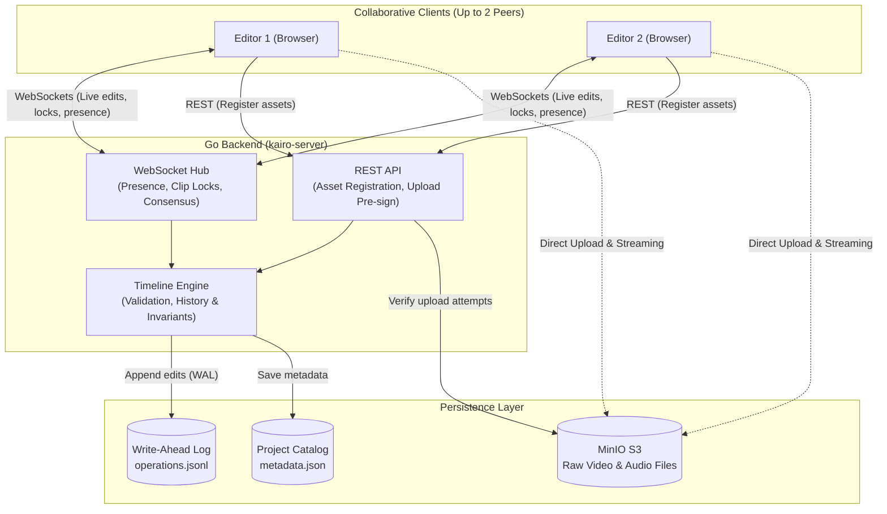

# Kairo

Kairo is a real-time collaborative video editor built for pairs. It combines zero-latency local media playback with an append-only Go backend, fine-grained clip locking, and two-party consensus for structural edits.

---

## System Architecture

Kairo coordinates two editors using a lightweight hybrid architecture: live coordination happens over WebSockets, media streams directly to/from S3-compatible storage, and the Go server enforces timeline invariants using an append-only log.



### How It Works (In Simple Words)

1. **Immediate Playback (Zero Lag)**: When you drop a video into Kairo, it plays instantly from local browser memory (IndexedDB) without waiting for uploads to finish.
2. **Direct-to-S3 Uploads**: In the background, original files are uploaded directly from the browser to MinIO using pre-signed policies, bypassing the Go server to keep bandwidth light. If your peer needs the file, they stream it from MinIO.
3. **Live Collaboration**: Both editors connect to the Go server via WebSockets:
   - **Presence**: You can see your peer's playhead, cursor, and selected clips in real time.
   - **Clip Locks**: Clicking or dragging a clip acquires an exclusive lock so peers cannot edit the same clip at the same time.
   - **Consensus**: Dangerous edits (like deleting a track or resetting the timeline) trigger a 30-second voting prompt requiring both users to agree.
4. **Append-Only History**: The Go engine validates every edit (e.g. ensuring clips never overlap on the same track) and appends it to a write-ahead log (`operations.jsonl`) for reliable undo, redo, and crash recovery.

---

## Codebase Structure

- **Backend (`server/`)**: Built with **Hexagonal Architecture (Ports & Adapters)**. Core domain rules (`domain/`) and application logic (`app/`) are isolated from HTTP/WebSocket transports and MinIO/JSONL storage through clean Go interfaces (`ports/`).
- **Frontend (`client/src/features/editor/`)**: Built with a **Domain-Hook-View** pattern. Pure timeline math and calculations (`domain/`) have zero React/DOM dependencies, controller hooks (`hooks/`) manage event listeners, and thin TSX components (`components/`) render the Remotion player and UI.

---

## Getting Started

### Prerequisites
- [Docker Compose](https://docs.docker.com/compose/)
- [Go](https://go.dev/) (1.22+)
- [Node.js](https://nodejs.org/) (20+)

### 1. Start MinIO Storage & Backend

```sh
docker compose up -d --build minio
cd server && go run ./cmd/kairo-server
```

*The server will start on `http://127.0.0.1:8080`.*

### 2. Start Frontend

In a separate terminal:

```sh
cd client
npm ci
npm run dev
```

Open the local Vite URL printed in your terminal (proxies `/api` directly to the Go server).

---

## Configuration

| Variable | Default | Purpose |
|---|---|---|
| `KAIRO_ADDR` | `127.0.0.1:8080` | Server listen address |
| `KAIRO_DATA_DIR` | `data` | Directory for `metadata.json` and `operations.jsonl` |
| `MINIO_ENDPOINT` | `127.0.0.1:9000` | MinIO S3 endpoint |
| `MINIO_BUCKET` | `kairo-media` | Target bucket for uploaded originals |
| `KAIRO_MAX_UPLOAD_BYTES` | `262144000` (250 MiB) | Maximum allowed upload size per asset |

---

## Testing

Run tests across both backend and frontend:

```sh
# Backend tests with race detector
(cd server && go test -race -v ./...)

# Frontend domain tests & production build
(cd client && npm test && npm run build)
```
