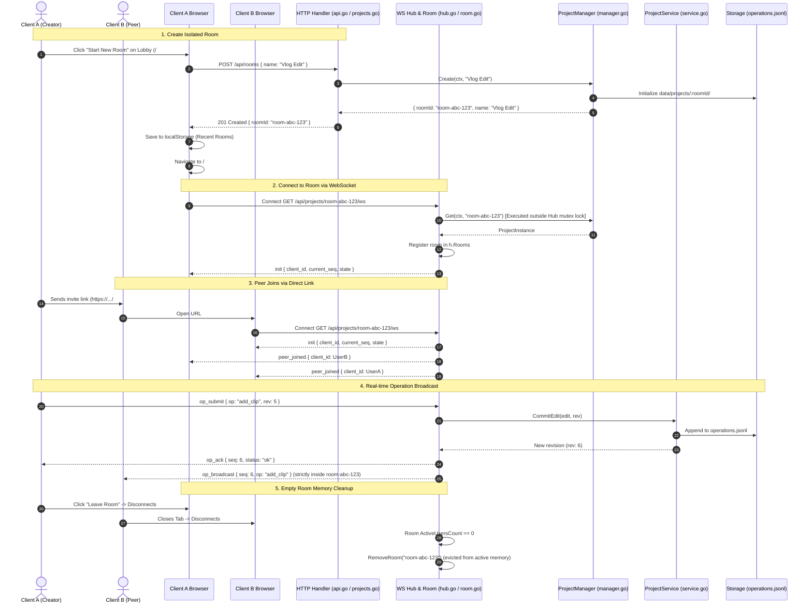

# Kairo Isolated Collaboration Room Architecture

This document describes Kairo's isolated collaboration room architecture, lifecycle management, and end-to-end data flows.

---

## 1. System & Module Architecture

```mermaid
flowchart TD
    subgraph Client ["Frontend (React + Zustand + TypeScript)"]
        direction TB
        App["App.tsx (Hash Router)"]
        
        subgraph LobbyMod ["features/lobby/"]
            LobbyUI["Lobby.tsx (Create / Join Room)"]
            LobbyStore[("localStorage: Recent Rooms")]
            LobbyAPI["api/client.ts (POST /api/rooms)"]
        end

        subgraph EditorMod ["features/editor/"]
            EditorUI["EditorView (MediaBin, Preview, Timeline)"]
            EditorStore["state/store.ts (useEditor)"]
            EditorWS["api/ws.ts (projectSocket)"]
            EditorAPI["api/client.ts (commitEdit, assets)"]
        end

        subgraph ExportMod ["features/export/"]
            ExportUI["ExportModal.tsx"]
            ExportStore["state/useExportStore.ts"]
            ClientExporter["engine/clientExporter.ts (WebCodecs)"]
        end

        App -->|"/#/ (Lobby)"| LobbyUI
        App -->|"/#/room/:roomId"| EditorUI
        LobbyUI --> LobbyAPI
        LobbyUI <--> LobbyStore
        EditorUI --> EditorStore
        EditorStore --> EditorWS
        EditorStore --> EditorAPI
        EditorUI --> ExportUI
        ExportUI --> ExportStore
        ExportStore --> ClientExporter
    end

    subgraph Network ["HTTP & WebSocket Transport"]
        RoomEndpoint["POST /api/rooms"]
        HTTPRouter["/api/projects/:roomId/* & /api/exports/*"]
        WSRoute["/api/projects/:roomId/ws"]
    end

    LobbyAPI -->|REST| RoomEndpoint
    EditorAPI -->|REST| HTTPRouter
    ExportStore -->|REST| HTTPRouter
    EditorWS -->|WebSocket| WSRoute

    subgraph Server ["Backend (Go / Hexagonal Architecture)"]
        direction TB
        Main["cmd/kairo-server/main.go"]

        subgraph Inbound ["adapters/inbound/"]
            HTTPHandler["http/projects.go & http/api.go"]
            WSHub["ws/hub.go (Hub)"]
            WSRoom["ws/room.go (Room: scoped per roomId)"]
        end

        subgraph AppServices ["app/ (Application Core)"]
            ProjManager["project/manager.go (ProjectManager)"]
            ProjService["project/service.go (ProjectService)"]
            ExportService["export/service.go (ExportService)"]
        end

        subgraph Outbound ["adapters/outbound/"]
            JSONLStore["storage/jsonl/ (Append-only Log)"]
            FFmpegAdapter["ffmpeg/ (FFmpeg Engine)"]
        end

        Main --> HTTPHandler
        Main --> WSHub
        Main --> ProjManager
        
        HTTPHandler --> ProjManager
        HTTPHandler --> ExportService
        WSHub --> WSRoom
        WSRoom --> ProjService
        
        ProjManager -->|GetOrLoad / Create| ProjService
        ProjService --> JSONLStore
        ExportService --> ProjManager
        ExportService --> FFmpegAdapter
    end

    subgraph Disk ["Storage / Persistence Layer"]
        ProjDir["data/projects/:roomId/"]
        MetaJSON["data/projects/:roomId/metadata.json"]
        OpsJSONL["data/projects/:roomId/operations.jsonl"]
        ExportsDir["data/exports/:roomId/:id/export.mp4"]
    end

    ProjService --> ProjDir
    ProjDir --> MetaJSON
    ProjDir --> OpsJSONL
    FFmpegAdapter --> ExportsDir
```

---

## 2. End-to-End Workflow & Lifecycle Sequence

---

## 3. Module & File Directory Map

### Frontend Modules (`client/src/`)
- [App.tsx](file:///home/jsndz/code/projects/Kairo/client/src/App.tsx): Application root with hash-based router (`/#/` $\to$ Lobby, `/#/room/:roomId` $\to$ Editor), "Leave Room" navigation, and "Share Invite" link generator.
- [route.ts](file:///home/jsndz/code/projects/Kairo/client/src/route.ts): Route parser supporting `view: 'home'`, `view: 'lobby'`, and `view: 'editor'` with unguessable `roomId`.
- **Lobby Feature** ([client/src/features/lobby/](file:///home/jsndz/code/projects/Kairo/client/src/features/lobby/)):
  - [types.ts](file:///home/jsndz/code/projects/Kairo/client/src/features/lobby/types.ts): `RecentRoom` type definition.
  - [storage.ts](file:///home/jsndz/code/projects/Kairo/client/src/features/lobby/storage.ts): Browser `localStorage` persistence for private, device-only room history.
  - [client.ts](file:///home/jsndz/code/projects/Kairo/client/src/features/lobby/api/client.ts): REST client for `POST /api/rooms`.
  - [Lobby.tsx](file:///home/jsndz/code/projects/Kairo/client/src/features/lobby/components/Lobby.tsx): Dedicated lobby screen with "Create Room", "Join Room", and "Recent Rooms".
- **Editor Feature** ([client/src/features/editor/](file:///home/jsndz/code/projects/Kairo/client/src/features/editor/)):
  - [client.ts](file:///home/jsndz/code/projects/Kairo/client/src/features/editor/api/client.ts): Room-scoped REST client (`/api/projects/:roomId/*`).
  - [ws.ts](file:///home/jsndz/code/projects/Kairo/client/src/features/editor/api/ws.ts): Room-scoped WebSocket client (`/api/projects/:roomId/ws`).
  - [store.ts](file:///home/jsndz/code/projects/Kairo/client/src/features/editor/state/store.ts): Global editor store with `initialize(roomId)` and `reset()`.
- **Export Feature** ([client/src/features/export/](file:///home/jsndz/code/projects/Kairo/client/src/features/export/)):
  - [useExportStore.ts](file:///home/jsndz/code/projects/Kairo/client/src/features/export/state/useExportStore.ts): Server export job polling and local in-browser render engine.
  - [ExportModal.tsx](file:///home/jsndz/code/projects/Kairo/client/src/features/export/components/ExportModal.tsx): Room-scoped export modal.

### Backend Packages (`server/`)
- [cmd/kairo-server/main.go](file:///home/jsndz/code/projects/Kairo/server/cmd/kairo-server/main.go): Application entry point; initializes stores, managers, services, and the WebSocket hub.
- **Application Services** (`server/internal/app/`):
  - [manager.go](file:///home/jsndz/code/projects/Kairo/server/internal/app/project/manager.go): `ProjectManager` handling lazy loading and idle eviction.
  - [service.go](file:///home/jsndz/code/projects/Kairo/server/internal/app/project/service.go): Single-room timeline service managing operations, revisions, and undo/redo stacks.
- **Inbound Transport Adapters** (`server/internal/adapters/inbound/`):
  - [projects.go](file:///home/jsndz/code/projects/Kairo/server/internal/adapters/inbound/http/projects.go): HTTP handler for `POST /api/rooms` and `/api/projects/{projectId}/*`.
  - [hub.go](file:///home/jsndz/code/projects/Kairo/server/internal/adapters/inbound/ws/hub.go): Non-blocking multi-room WebSocket hub routing messages strictly within room boundaries.
  - [room.go](file:///home/jsndz/code/projects/Kairo/server/internal/adapters/inbound/ws/room.go): Per-room collaboration tracking with automatic `RemoveRoom` cleanup when empty.
