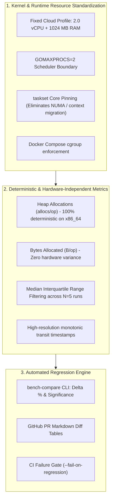

# Kairo Standardized Benchmarking, Load & Stress Suite

This directory contains the reproducible, hardware-isolated benchmarking engine, baseline records, and statistical comparison tooling for Kairo.

Following industry standards from **Figma**, **Liveblocks**, and the **Linux Foundation**, the suite isolates performance from host hardware variability, enforces deterministic resource quotas, and provides automated statistical regression detection.

---

## 1. Deterministic Metrics & Hardware Isolation Principles

When benchmarking in multi-tenant cloud environments or across different developer workstations, raw wall-clock numbers can be skewed by CPU clock boosts, thermal throttling, and varying core counts. Kairo standardizes benchmarking using three industry techniques:



1. **Hardware-Independent Deterministic Metrics**:
   - `allocs/op` and `B/op` (Heap allocations and bytes): Go's memory escape analysis is **100% deterministic**. The same timeline operation allocates the exact same number of bytes regardless of whether it runs on a high-end desktop or a cloud runner.
2. **Standardized Server Profile (2 vCPU / 1GB RAM)**:
   - Sets `GOMAXPROCS=2` to mimic a standard cloud container shape.
   - Pinned CPU affinity via `taskset -c 0,1` to eliminate cache-thrashing and core-hopping jitter.
   - Hard cgroups limit via Docker Compose: `cpus: '2.0'`, `memory: 1024M`.
3. **Statistical Median Sampling**:
   - Every benchmark runs $N=5$ iterations. The comparison engine computes medians rather than noisy means to reject outliers.

---

## 2. Storing & Comparing Benchmarks

### File Layout
- `benchmarks/results/baseline_jsonl.txt`: Golden reference baseline for the file-based JSONL write-ahead log.
- `benchmarks/results/current.txt`: The latest benchmark run for candidate evaluation.
- `benchmarks/k6/`: External HTTP and WebSocket load scripts.

### Automated Statistical Comparison Tool (`bench-compare`)
Built directly into the codebase ([server/cmd/bench-compare/main.go](file:///home/jsndz/code/projects/Kairo/server/cmd/bench-compare/main.go)), this tool compares two benchmark runs, calculates percentage deltas, checks memory drift, and issues a verdict (`OK`, `FASTER`, or `REGRESSION`):

```bash
# Compare current run against golden baseline
make compare

# Output markdown table for GitHub PRs
go run ./server/cmd/bench-compare --format=markdown benchmarks/results/baseline_jsonl.txt benchmarks/results/current.txt

# Enforce strict CI regression gate (exits with code 2 if degradation > 5%)
go run ./server/cmd/bench-compare --fail-on-regression --threshold=5.0 benchmarks/results/baseline_jsonl.txt benchmarks/results/current.txt
```

---

## 3. Comprehensive Command Reference

### Universal Commands (Run from Root)

| Command | Subsystem Tested | Description |
| :--- | :--- | :--- |
| `make bench-all` | **Full Application** | Runs all 4 stages: Storage $\to$ Frontend $\to$ Export $\to$ WebSockets. |
| `make baseline` | **Storage / Core** | Captures 5-run golden baseline under standardized 2-vCPU profile. |
| `make compare` | **Regression Engine** | Runs candidate benchmarks and prints statistical delta table. |
| `make bench-isolated` | **Hardware Isolation** | Runs benchmarks with `GOMAXPROCS=2` and CPU affinity pinning. |
| `make bench-docker` | **Container Sandbox** | Runs benchmarks inside strict 2.0 CPU / 1GB RAM container. |
| `make bench-load` | **Live WebSockets** | 100 rooms, 200 paired peers, 500 ops/sec real-time load test. |
| `make bench-export` | **Backend Export** | 20 concurrent export jobs, queue saturation, status polling. |
| `make bench-frontend` | **Frontend Engine** | 1,000-clip composition ordering, zoom transforms, drag bounds. |
| `make stress` | **Chaos / Resilience** | Crash recovery, 50-writer conflict race, lock storm, queue caps. |
| `make race` | **Thread Safety** | Go data race detector across the entire server codebase. |
| `make test` | **Unit & Domain** | Complete unit test suite for backend and frontend. |

### k6 External Load Testing
```bash
# Local k6
k6 run benchmarks/k6/rest_api_stress.js
k6 run benchmarks/k6/websocket_stress.js

# Docker k6 (Zero local installation)
docker run --rm -i --net=host -v "$PWD/benchmarks/k6:/scripts" grafana/k6 run /scripts/rest_api_stress.js
```
